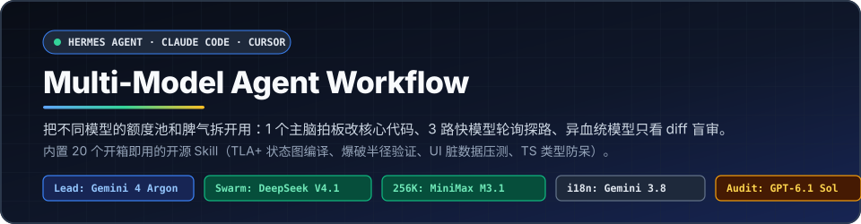
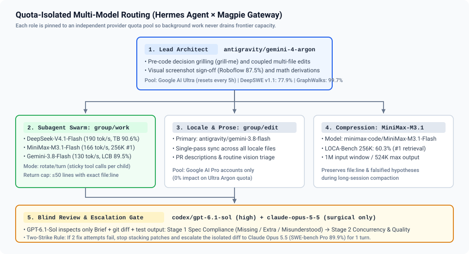
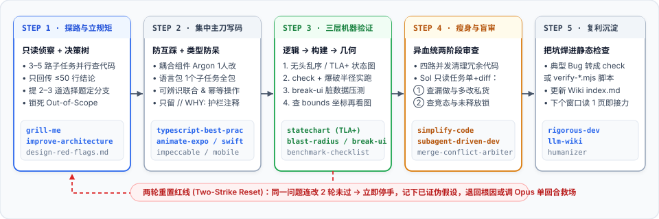

<div align="center">



[](./LICENSE)
[](./skills)
[](#quickstart)
[](./README.en.md)

<p>Don't burn flagship model tokens scrolling through thousands of lines in the main window, and don't let seven subagents write to your active branch at once.<br>
Here is a multi-model workflow built around real engineering friction, bundled with 20 day-to-day coding skills.</p>

**English** · [简体中文](./README.md) · [Benchmarks](./docs/benchmarks-2026-11.md) · [Engineering Patterns](./docs/power-user-patterns.md)

</div>

---

When building full-stack TypeScript, React Native, Swift, and embedded apps, two issues kept breaking my flow:

First, burning quotas on low-leverage tasks while everything crawled to a halt. Using an expensive reasoning model to run global grep searches, or pushing every background subtask into one free, slow queue. The main window ran out of tokens before lunch, and background jobs backed up completely.

Second, merge conflicts from uncontrolled concurrency. When multiple subagents touch interdependent UI components, shared state stores, and translation dictionaries at the same time, the branch won't even compile tests half an hour later, forcing a complete git reset.

This setup centers on a straightforward division of labor:
1. Reserve the main window for the top-tier model to handle architecture choices and core diffs. It does best with UI screenshot checks and complex state machines.
2. Route repo searches and routine legwork to fast models rotated across three distinct providers, avoiding rate limits on any single account.
3. Use a completely different model family for read-only diff reviews. The model that wrote the code should not review it, and an outside model quickly flags smuggled scope changes.

<div align="center">
  
</div>

---

## Quickstart

The bundled `skills/` directory includes 20 curated engineering skills under their original upstream licenses. Clone the repo and run one script to set them up.

```bash
git clone https://github.com/dreamfarer-space/multi-model-agent-workflow.git
cd multi-model-agent-workflow

# 1. Install all 20 skills (supports hermes / claude / cursor / agents)
bash scripts/install-skills.sh --target hermes

# 2. If using the Magpie proxy gateway, set up routing groups
bash scripts/setup-magpie-groups.sh
```

If you use Hermes Agent, save these options into your configuration (see `configs/hermes-config.example.yaml` for a complete template):

```bash
hermes config set model.default antigravity/gemini-4-argon
hermes config set delegation.model group/work
hermes config set delegation.max_concurrent_children 5
hermes config set delegation.independent_completions true
hermes config set delegation.prefix_stagger_seconds 8
hermes config set delegation.child_timeout_seconds 1800
hermes config set delegation.max_summary_chars 8000
hermes config set terminal.timeout 600
hermes config set tool_loop_guardrails.hard_stop_enabled true
hermes config set auxiliary.compression.model minimax-code/MiniMax-M3.1-Flash
hermes config set auxiliary.review.model codex/gpt-6.1-sol
hermes config set auxiliary.background_review.model codex/gpt-6.1-sol
hermes config set auxiliary.background_review.reasoning_effort high
```

---

## Model Roles and Assignments

Different models have very different strengths during development. See [Benchmarks Summary](./docs/benchmarks-2026-11.md) for detailed test figures and third-party evaluation methodologies. In daily work, assign roles by capability rather than having your flagship model handle low-level chores:

| Role | Route / Config | Public Benchmarks | Rationale |
| :--- | :--- | :--- | :--- |
| **Main Window Decisions** | `antigravity/gemini-4-argon`<br>`model.default` | DeepSWE v1.1 `77.9%`<br>GraphWalks 128K `99.7%`<br>Roboflow Vision `87.5%` | Cross-file call chain tracking and visual screenshot alignment stay solid. Initial thinking time can take ten to fifteen seconds, so keep it away from raw file crawling. Use it strictly for architectural trade-offs and touching core coupled logic. Runs on the Google AI Ultra pool with a 5-hour reset window. |
| **Subtask Reconnaissance** | `group/work`<br>`routing=rotate, stays=turn` | DeepSeek-V4.1-Flash (`190 tok/s`)<br>MiniMax-M3.1-Flash (`166 tok/s`)<br>Gemini-3.8-Flash (`130 tok/s`) | Background subtasks rotate across Tencent, MiniMax, and Google Pro, preventing any single provider from bottlenecking your session. `stays=turn` keeps a subtask locked to one model across multi-step tool calls so state stays coherent. Backed by `workbuddy/hy4free` as a fallback. |
| **Localization & Copy** | `antigravity/gemini-3.8-flash`<br>`group/edit` | LMArena Chinese Vision #1<br>LiveCodeBench `89.5%` | Isolated to the Google AI Pro pool to spare Ultra quota. Handles batch updates across translation dictionaries (`locales/*.ts`) and draft release notes with high single-pass throughput. |
| **Context Compression** | `minimax-code/MiniMax-M3.1-Flash`<br>`auxiliary.compression` | LOCA-Bench 256K `60.3%` (#1 long-context retrieval)<br>Max single output `524K` | Engages automatically when long sessions trigger compaction. Strong context retention ensures previously checked `file:line` references and ruled-out hypotheses are not dropped. |
| **Blind Review & Rescue** | Blind review: `codex/gpt-6.1-sol:high`<br>Rescue: `claude-opus-5-5` | Sol: DeepSWE `75.2%`, Instruction Following `82.0%`<br>Opus 5.5: SWE-bench Pro `89.9%` | When code is written in the main window, switch to OpenAI-lineage Sol before committing to catch oversights. Opus 5.5 quota is scarce; instead of keeping it in the main window for long runs, bring it in for a single targeted turn when the primary model fails two fix attempts in a row. |

---

## Day-to-Day Engineering Workflow

<div align="center">
  
</div>

This workflow pulls together practical techniques from Boris Cherny, Jesse Vincent (`superpowers`), Garry Tan (`gstack`), Matt Pocock (`grill-me`), Emil Kowalski, and Lauren Tan (`cursor/pstack`). For deeper architectural rationale, see [Engineering Patterns](./docs/power-user-patterns.md).

### 1. Scope boundaries and clarify options before touching code

The main window never browses large files directly. Dispatch 3 to 5 read-only subtasks for initial reconnaissance, capping each summary at 50 lines with explicit `file:line` anchors instead of dumping raw logs.

Whenever hitting architectural forks or trade-offs, the main model uses `grill-me` to present 2 to 3 opinionated multiple-choice paths to lock in the plan. It also lists explicit out-of-scope files before writing code. If something can be verified directly from the codebase, the agent checks it without bothering you.

### 2. Single-owner edits on coupled code, hard stop after two failed attempts

Interconnected components, shared state, and routing flows must be modified in a single uninterrupted pass by `Argon` in the main session. When updating localization copy, finish the base source file first, then dispatch one `Gemini 3.8 Flash` subtask to update the full dictionary bundle at once, avoiding concurrent writes across tasks.

TypeScript conventions are strictly applied: discriminated unions replace scattered boolean flags, Zod validates types at network and storage boundaries, and state mutations must be idempotent. Comments stick to `// WHY:` explanations that document platform edge cases or protocol quirks, protecting defensive code from being cleaned up by subsequent models.

Two-strike reset rule: if a bug fix fails tests two rounds in a row, stop immediately. Adding a third layer of speculative patches is banned. Roll back to the baseline context, re-verify the original assumptions, or switch to `opus` for a single-pass root cause check.

### 3. Three layers of machine validation over manual inspection

Isolate state machine logic first. When dealing with reconnects, preemption, or permission flows, extract the state logic into standalone permutations tests, or use `statechart` to run TLC and output TLA+ specs directly as Mermaid diagrams with minimal counterexample traces.

Verify against real runtime evidence. After unit tests pass, use `blast-radius` to trace cross-module dependencies down to the core assumption and verify it with a minimal test script. Mark any call site without live runtime proof as `UNPROVEN`. Performance claims must complete all 7 checks in `benchmark-checklist`.

Stress-test visual layouts with edge-case data. Run `break-ui` using long German compound words, oversized email addresses, and boundary empty/full collections. Inspect layout metrics using Android `bounds` or DOM `getBoundingClientRect` coordinates, then feed light and dark mode screenshots back to the main model for final verification.

### 4. Code pruning and cross-lineage blind review

For sizable diffs, run `simplify-code` to identify existing library helpers, unclosed event listeners, and redundant component state.

Before committing, hand the branch off to `GPT-6.1-Sol (high)`. The review runs without earlier chat history, receiving only the task prompt, the actual `git diff`, and test output:
* First pass checks alignment against requirements: confirm nothing was skipped and no unrequested scope was slipped in.
* Second pass inspects robustness: watch for resource leaks, race conditions, and unhandled errors.

### 5. Turn past traps into static checks (Lint-as-Memory)

Models eventually forget written documentation, but code cannot merge if CI fails. Whenever you resolve a tricky pitfall (such as nested paddings, hardcoded hex values, or missing translation keys), add a regex pattern or static assertion to your lint scripts.

For architectural decisions or system designs, use `llm-wiki` to log them under the local knowledge base index. Future sessions can pick up full context just by reading `index.md`.

---

<details>
<summary><b>Bundled skills and license reference</b></summary>
<br>

All skills are located in the [`skills/`](./skills) directory. See [`THIRD_PARTY_NOTICES.md`](./THIRD_PARTY_NOTICES.md) for full attribution and license terms.

| Category | Directory | Description | Source & License |
| :--- | :--- | :--- | :--- |
| **Architecture & Core Dev** | `rigorous-dev` | Core pipeline orchestrating branch analysis, two-strike resets, layout checks, and blind reviews | MIT (`Nous Research` / Extended in this repo) |
| | `grill-me` | Asks developers targeted decision questions with recommendations before implementation | MIT (`mattpocock/skills`) |
| | `improve-codebase-architecture` | Identifies shallow module abstractions and flags three common architectural code smells | MIT (`mattpocock/skills` + `cursor/pstack`) |
| | `typescript-best-practices` | Discriminated unions, nominal types, Zod boundary validation, and exhaustive matching | MIT (`cursor/plugins/pstack`) |
| | `blast-radius` | Evaluates cross-module blast radius and builds an evidence ladder for runtime assumptions | MIT (`cursor/plugins/pstack`) |
| | `statechart` | Compiles TLA+ specifications into Mermaid statecharts and counterexample paths using SANY and TLC | MIT (`cursor/plugins/pstack`) |
| | `benchmark-checklist` | 7-point verification checklist to prevent exaggerated performance claims | MIT (`cursor/plugins/pstack`) |
| | `simplify-code` | Refines recent changes for reuse, clarity, and performance | MIT (`Nous Research`) |
| | `subagent-driven-development` | Drives subagents with spec and code quality reviews before handoff | MIT (`obra/superpowers`) |
| | `agent-merge-conflict-arbiter` | Resolves Git merge conflicts by reconciling commit intent and test results | MIT (`Nous Research`) |
| **UI & Multiplatform** | `vercel-react-native-skills` | Guidelines for React Native and Expo list rendering, layouts, and native interactions | MIT (`vercel-labs/agent-skills`) |
| | `animate-expo` | Reanimated motion guardrails, jank prevention during frequent updates, and UI thread gestures | MIT (`emilkowalski/skills`) |
| | `break-ui` | Injects long German strings, extreme email lengths, and empty/full states for boundary testing | MIT (`emilkowalski/skills`) |
| | `mobile-native` | Prevents mobile web `:hover` stickiness, viewport height bugs, and form zoom issues | MIT (`emilkowalski/skills`) |
| | `write-swift` | Modern Swift value-type patterns and structured concurrency standards | MIT (`emilkowalski/skills`) |
| | `emil-design-eng` | UI craftsmanship and transition timing guidelines from Emil Kowalski | MIT (`emilkowalski/skills`) |
| | `impeccable` | Typography, contrast ratios, visual hierarchy, and anti-template styling rules | Apache-2.0 (`pbakaus/impeccable`) |
| | `frontend-design` | Principles to avoid generic frontend styling and add tactile visual polish | Apache-2.0 (`anthropics/skills`) |
| **Docs & Knowledge** | `humanizer` | Filters 34 common AI boilerplate habits and hollow phrasing patterns | MIT (`blader/humanizer`) |
| | `llm-wiki` | Maintains an incremental local knowledge base using `raw/`, `concepts/`, and `index.md` | MIT (`Nous Research`) |

</details>

---

<details>
<summary><b>Repository layout</b></summary>
<br>

```text
.
├── README.md                          # Chinese documentation
├── README.en.md                       # English documentation
├── LICENSE                            # Repository MIT license
├── THIRD_PARTY_NOTICES.md             # Upstream copyright and license notices for all 20 skills
├── assets/
│   ├── hero.svg                       # Header graphic
│   ├── model-routing.svg              # Model roles and routing topology
│   └── pipeline.svg                   # Five-step verification workflow diagram
├── configs/
│   └── hermes-config.example.yaml     # Hermes routing groups and anti-loop configuration template
├── scripts/
│   ├── install-skills.sh              # Skill installation script (Hermes / Claude / Cursor / .agents)
│   └── setup-magpie-groups.sh         # Magpie routing group configuration script
├── skills/                            # 20 bundled engineering skills
│   ├── autonomous-ai-agents/
│   ├── creative/
│   ├── research/
│   └── software-development/
└── docs/
    ├── benchmarks-2026-11.md          # Benchmark numbers and verification notes for major models
    └── power-user-patterns.md         # In-depth breakdown of engineering patterns and acceptance criteria
```

</details>

---

## License

New configurations, diagrams, and documentation in this repository are released under the [MIT License](./LICENSE). Bundled third-party projects inside `skills/` remain under their original **MIT** or **Apache 2.0** licenses. See individual skill directories and the root [Third-Party Notices](./THIRD_PARTY_NOTICES.md) for details.
