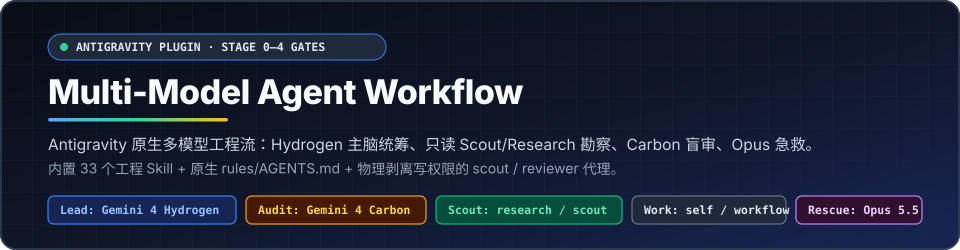
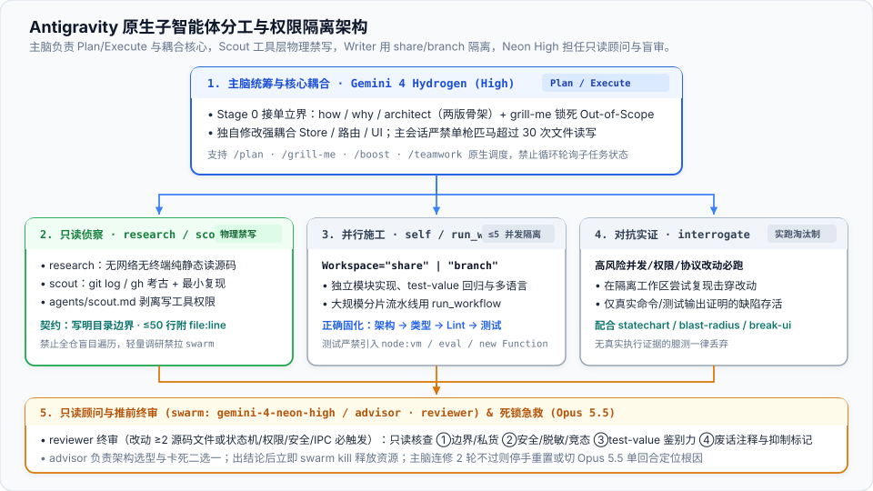
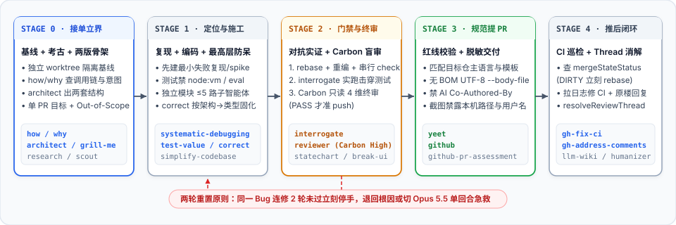

<div align="center">



[](./LICENSE)
[](./skills)
[](#quickstart)
[](./README.md)

<p>A production multi-model engineering workflow with a native Antigravity plugin, sanitized cross-tool rule templates, and 40 curated engineering skills.</p>

**English** · [简体中文](./README.md) · [Benchmarks](./docs/benchmarks-2026-11.md) · [Engineering Patterns](./docs/power-user-patterns.md)

</div>

---

When running AI coding agents on real repositories, three failure modes keep showing up:

First, burning flagship context and quota while mixing exploration with coupled edits. Reading thousands of lines in the main window or letting multiple subagents write to the same directory leaves the branch broken beyond quick recovery.

Second, confirmation bias during self-review. When the same model and chat thread that wrote the patch also reviews it, skipped edge cases, unrequested scope additions, and hollow tests slip straight through.

Third, relying on soft prompt reminders instead of structural enforcement. Written rules get ignored under pressure unless backed by tool-level read-only isolation, a gated 5-stage pipeline, and static checks.

This setup addresses all three directly:
1. **Strict role and tool separation**: The lead model (`Gemini 4 Hydrogen (High)` or Hermes `Argon`) owns architectural decisions and coupled core code; `research` and `scout` strip file-editing tools for bounded read-only reconnaissance with `file:line` citations; independent implementation runs in isolated worktrees or the 3-family `group/work` pool (capped at ≤5 concurrent).
2. **5-stage hard-gated pipeline (Stage 0 – Stage 4)**: Ground with `how` + `why` + `architect` before coding; build with `systematic-debugging`, `test-value`, and `correct`; verify before push using `interrogate` (command-proven findings only) and a read-only `reviewer` (`Gemini 4 Carbon (High)` or `GPT-6.1-Sol`) auditing four mandatory dimensions; close CI with `mergeStateStatus` checks and GraphQL `resolveReviewThread`.
3. **Portable across agent runtimes**: Install the same 40 skills and sanitized rule templates into **Google Antigravity**, **Hermes Agent**, **Pi / Claude Code**, or **Cursor**.

<div align="center">
  
</div>

---

## Quickstart

This repository includes the sanitized Antigravity plugin (`plugins/workflow/`), a cross-tool rules template (`configs/AGENTS.example.md`), Hermes + Magpie templates, and **40 curated engineering skills** under their original upstream licenses.

```bash
git clone https://github.com/dreamfarer-space/multi-model-agent-workflow.git
cd multi-model-agent-workflow

# 1. Install into your target runtime (antigravity / hermes / claude / cursor / agents)
bash scripts/install-skills.sh --target antigravity
# Or install skills into Hermes / Claude Code / Cursor / ~/.agents:
# bash scripts/install-skills.sh --target hermes

# 2. (Optional) Configure Magpie routing groups
bash scripts/setup-magpie-groups.sh
```

- **Pi / Claude Code users**: Copy [`configs/AGENTS.example.md`](./configs/AGENTS.example.md) to `~/.pi/agent/AGENTS.md` or `~/.claude/CLAUDE.md` to route main/worker turns through `antigravity/gemini-4-hydrogen`, independent pre-push audits through `antigravity/gemini-4-carbon`, and deadlock rescues through `antigravity/claude-opus-5-5`.
- **Hermes Agent users**: See [`configs/hermes-config.example.yaml`](./configs/hermes-config.example.yaml) for the full configuration, or apply core settings via CLI:

```bash
hermes config set model.default antigravity/gemini-4-hydrogen
hermes config set delegation.model group/work
hermes config set delegation.max_concurrent_children 5
hermes config set delegation.independent_completions true
hermes config set delegation.prefix_stagger_seconds 8
hermes config set delegation.child_timeout_seconds 1800
hermes config set delegation.max_summary_chars 8000
hermes config set terminal.timeout 600
hermes config set tool_loop_guardrails.hard_stop_enabled true
hermes config set auxiliary.compression.model minimax-code/MiniMax-M3.1-Flash
hermes config set auxiliary.review.model antigravity/gemini-4-carbon
hermes config set auxiliary.background_review.model codex/gpt-6.1-sol
hermes config set auxiliary.background_review.reasoning_effort high
```

---

## Model Roles and Dual-Stack Routing

| Role | Antigravity / Pi (Current Stack) | Hermes × Magpie (Quota-Isolated Stack) | Scope & Guardrails |
| :--- | :--- | :--- | :--- |
| **Lead & Coupled Core** | `Gemini 4 Hydrogen (High)` | `antigravity/gemini-4-argon` | Requirement convergence, two-skeleton `architect` design, coupled edits, final acceptance; never >30 solo file reads/edits in the root session. |
| **Read-Only Scouts** | `research` (sandboxed static)<br>`scout` (CLI without write tools) | `group/work` (`DeepSeek-V4.1` / `MiniMax-M3.1` / `Gemini-3.8-Flash`) | Runtime tracing (`how`), git/PR archaeology (`why`), minimal repro; capped at **≤25 tool calls, ≤8 files, ≤50 summary lines with `file:line`**. |
| **Parallel Implementation** | `self` (`share` / `branch` worktree)<br>`run_workflow` (Python pipeline) | `group/work` (`rotate, stays=turn`) + `worktree_isolation` | Independent modules, regression tests, single-task locale sync (**≤5 concurrent**; no same-turn multi-patch on one file). |
| **Pre-Push Blind Review** | `Gemini 4 Carbon (High)`<br>(`plugins/workflow/agents/reviewer.md`) | `codex/gpt-6.1-sol:high`<br>(`auxiliary.review`) | **No chat history** — receives only scope, `git diff`, and test output to audit 4 mandatory dimensions; blocks push until `PASS`. |
| **Compaction & Rescue** | Rescue: `claude-opus-5-5` | Compaction: `MiniMax-M3.1-Flash`<br>Rescue: `claude-opus-5-5` | Hard reset after two failed fix attempts or single-turn `Opus 5.5` root-cause escalation; `MiniMax` preserves `file:line` context during compaction. |

See [Benchmarks Summary (2026-11)](./docs/benchmarks-2026-11.md) for measured metrics and role selection rationale.

---

## Five-Stage Hard-Gated Pipeline (Stage 0 – Stage 4)

<div align="center">
  
</div>

This workflow enforces five sequential gates (detailed in [Engineering Patterns](./docs/power-user-patterns.md)):

1. **Stage 0 · Scope & Grounding**: Check target `AGENTS.md` and upstream baseline, **never branch directly in the main working tree** (use an isolated `git worktree`); ground with `how` and `why` before altering safeguards, sketch two distinct shapes with `architect`, and lock decisions + `Out of Scope` with `grill-me`.
2. **Stage 1 · Locate, Implement & Guard**: Build a tight failing loop first with `systematic-debugging` (or throwaway `spike`); follow `test-value` (**strict ban on `node:vm` / `eval` / `new Function` in tests**); eliminate recurring mistake classes at the highest effective level with `correct` (Architecture → Types → Lint → Behavioral Tests → Docs); prune bloat with `simplify-codebase`.
3. **Stage 2 · Local Gates & Pre-Push Audit**: Fetch and rebase onto upstream, rebuild artifacts, and run checks/tests sequentially; run `interrogate` on high-risk concurrency/auth/protocol changes (only command-proven findings survive); trigger read-only `reviewer` whenever ≥2 source files or state-machine/permission/security/IPC/redaction paths change.
4. **Stage 3 · Clean PR Delivery**: Follow repository templates and conventions (`yeet` / `github`), write `--body-file` in **BOM-free UTF-8**, match the repo's primary language, never add AI `Co-Authored-By` trailers or unsolicited review bots, and keep screenshots redacted and out of source branches.
5. **Stage 4 · Post-Push CI & Review Loop**: Check `gh pr view --json mergeStateStatus` immediately (rebase if `DIRTY` so CI isn't skipped), monitor `gh pr checks` + `gh-fix-ci`, and close feedback via `gh-address-comments` by replying in-thread and running GraphQL `resolveReviewThread`, cleaning up branches with `--delete-branch` after merge.

---

<details>
<summary><b>Bundled 40 skills and license reference</b></summary>
<br>

All skills live under [`skills/`](./skills). See [`THIRD_PARTY_NOTICES.md`](./THIRD_PARTY_NOTICES.md) for full upstream attribution and license terms.

| Category | Directory | Purpose | Source & License |
| :--- | :--- | :--- | :--- |
| **Stage 0 · Grounding & Design** | `how` | Codebase walkthroughs producing an onboarding-grade mental model | MIT (Adapted) |
| | `why` | Git/PR/issue archaeology separating proven facts from inference | MIT (Adapted) |
| | `architect` | Sketch two distinct type/signature skeletons before implementing | MIT (Adapted) |
| | `grill-me` | Frontier-round decision interview with recommended options | MIT (`rafaumeu` / `mattpocock` / Hermes) |
| | `improve-codebase-architecture` | Flags shallow abstractions and three AI architecture red flags | MIT (`mattpocock/skills` + `cursor/pstack`) |
| **Stage 1 · Build, Test & Guard** | `systematic-debugging` | 4-phase root-cause debugging with tight red/green loops | MIT (`obra/superpowers` / Hermes) |
| | `spike` | Disposable feasibility prototypes before real implementation | MIT (`gsd-build/get-shit-done` / Hermes) |
| | `test-value` | Evaluates test discrimination and feedback cost | MIT (`tt-a1i`) |
| | `correct` | Eliminates repeat agent mistakes at highest leverage level | MIT (Adapted) |
| | `simplify-codebase` | Evidence-backed removal of dead code and accidental complexity | MIT (`simplify-codebase contributors`) |
| | `simplify-code` | Fast 3-pass cleanup for reuse, clarity, and performance | MIT (`Nous Research`) |
| | `security-best-practices` | Language-specific security audit for Python / JS / TS / Go | Apache-2.0 (`OpenAI / Codex`) |
| | `typescript-best-practices` | Discriminated unions, branded types, Zod boundary parsing | MIT (`cursor/plugins/pstack`) |
| | `rigorous-dev` | Hermes monolithic workflow (two-strike reset, patch rules, 3-point gate) | MIT (`dreamfarer-space` & `Nous Research`) |
| | `subagent-driven-development` | Subagent dispatch with spec and code quality reviews | MIT (`obra/superpowers`) |
| | `agent-merge-conflict-arbiter` | Resolves Git conflicts using commit intent and test checks | MIT (`Nous Research`) |
| | `codebase-inspection` | Inspects codebase LOC, languages, and ratios with `pygount` | MIT (`Nous Research`) |
| | `localization` | Locale catalog translation, review, and Android/iOS resource checks | MIT (`Nous Research`, sanitized) |
| | `node-inspect-debugger` | Debugs Node.js processes via `--inspect` and CDP CLI | MIT (`Nous Research`) |
| | `python-debugpy` | Debugs Python via `pdb` REPL and `debugpy` DAP | MIT (`Nous Research`) |
| **Stage 2 · Proof & Verification** | `interrogate` | Adversarial probers break changes; only executed repros survive | MIT (Adapted) |
| | `blast-radius` | Cross-module blast radius audit and 5-level evidence ladder | MIT (`cursor/plugins/pstack`) |
| | `statechart` | Compiles TLA+ specs into Mermaid statecharts and counterexamples | MIT (`cursor/plugins/pstack`) |
| | `benchmark-checklist` | 7-point gate against unverified performance claims | MIT (`cursor/plugins/pstack`) |
| **Stage 3 & 4 · PR & CI Loop** | `yeet` | Stage, commit, push, and open/update GitHub PRs cleanly | Apache-2.0 (`OpenAI / Codex`, sanitized) |
| | `github` | `gh` CLI hub for issues, reviews, repos, auth, and releases | MIT (`Nous Research`, sanitized) |
| | `gh-fix-ci` | Inspects failing GitHub Actions checks and builds fix plans | Apache-2.0 (`OpenAI / Codex`) |
| | `gh-address-comments` | Replies to PR threads and resolves them via GraphQL | Apache-2.0 (`OpenAI / Codex`) |
| | `github-pr-assessment` | Evaluates PR changes, check status, and merge likelihood | MIT (`Nous Research`) |
| **UI & Multiplatform** | `vercel-react-native-skills` | React Native / Expo rendering, layout, and native patterns | MIT (`vercel-labs/agent-skills`) |
| | `animate-expo` | Reanimated motion guardrails and UI-thread gestures | MIT (`emilkowalski/skills`) |
| | `break-ui` | Stress-tests UI layouts with worst-case strings and list bounds | MIT (`emilkowalski/skills`) |
| | `mobile-native` | Fixes mobile web `:hover` stickiness, `100dvh`, and input zoom | MIT (`emilkowalski/skills`) |
| | `write-swift` | Modern Swift value-type and structured concurrency patterns | MIT (`emilkowalski/skills`) |
| | `emil-design-eng` | UI polish, transition timing, and interaction craftsmanship | MIT (`emilkowalski/skills`) |
| | `impeccable` | Typography, contrast, hierarchy, and anti-template guidance | Apache-2.0 (`pbakaus/impeccable`) |
| | `frontend-design` | Practical layout, visual texture, and frontend craftsmanship | Apache-2.0 (`anthropics/skills`) |
| | `gemini-frontend-design` | Polished web UI design across layout, color, typography, motion | Apache-2.0 (`Google Gemini`) |
| **Docs & Knowledge** | `humanizer` | Strips 34 common AI writing patterns and filler phrases | MIT (`blader/humanizer`, sanitized) |
| | `llm-wiki` | Maintains incremental knowledge bases (`raw/`, `concepts/`, `index.md`) | MIT (`Nous Research`) |

</details>

---

<details>
<summary><b>Repository layout</b></summary>
<br>

```text
.
├── README.md                          # Chinese documentation
├── README.en.md                       # English documentation
├── LICENSE                            # Repository MIT license
├── THIRD_PARTY_NOTICES.md             # Upstream notices for all 40 skills
├── assets/
│   ├── hero.svg                       # Header graphic
│   ├── model-routing.svg              # Model roles and permission isolation diagram
│   └── pipeline.svg                   # Five-stage hard-gated pipeline diagram
├── plugins/
│   └── workflow/                      # Sanitized Antigravity native plugin bundle
│       ├── plugin.json
│       ├── README.md
│       ├── agents/
│       │   ├── reviewer.md            # Strictly read-only 4-dimension auditor
│       │   └── scout.md               # Read-only + CLI investigator (no write tools)
│       └── rules/
│           └── AGENTS.md              # 5-stage hard-gated workflow rules template
├── configs/
│   ├── AGENTS.example.md              # Pi / Claude Code / Magpie rules template
│   └── hermes-config.example.yaml     # Hermes routing & guardrail configuration template
├── scripts/
│   ├── install-skills.sh              # Installer (Antigravity / Hermes / Claude / Cursor / .agents)
│   └── setup-magpie-groups.sh         # Magpie routing group setup script
├── skills/                            # 40 bundled engineering skills
│   ├── autonomous-ai-agents/
│   ├── creative/
│   ├── research/
│   └── software-development/
└── docs/
    ├── benchmarks-2026-11.md          # Measured benchmarks & dual-stack model selection
    └── power-user-patterns.md         # In-depth breakdown of Stage 0–4 engineering gates
```

</details>

---

## License

New configurations, plugin templates, diagrams, and documentation in this repository are released under the [MIT License](./LICENSE). Bundled third-party projects inside `skills/` remain under their original **MIT** or **Apache 2.0** licenses. See individual skill directories and the root [Third-Party Notices](./THIRD_PARTY_NOTICES.md) for details.
