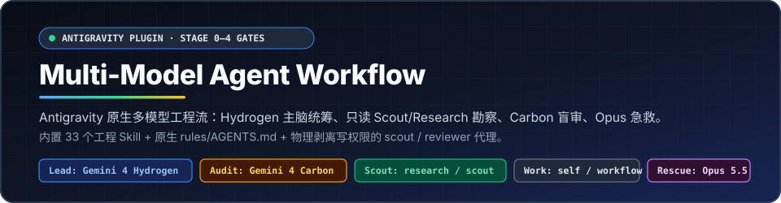
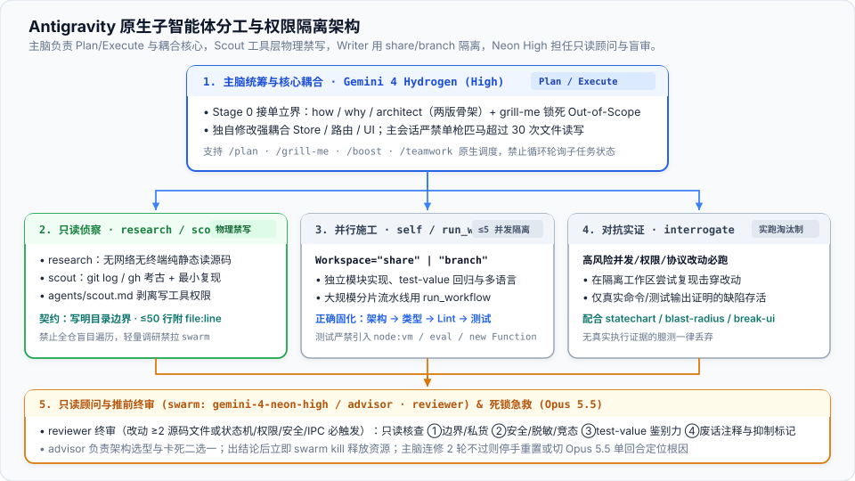
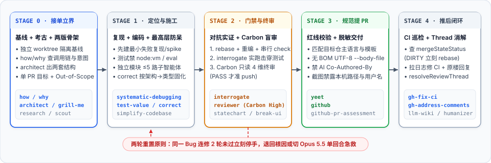

<div align="center">



[](./LICENSE)
[](./skills)
[](#最快上手)
[](./README.en.md)

<p>一套在真实全栈项目里打磨出来的多模型工程工作流，内置原生 Antigravity 插件包、跨工具规则模板与 40 个开箱即用的工程技能。</p>

[English](./README.en.md) · **简体中文** · [实测基准](./docs/benchmarks-2026-11.md) · [五阶段模式拆解](./docs/power-user-patterns.md)

</div>

---

写复杂项目时，AI Agent 最容易在三件事上翻车：

一是**主脑乱翻大文件烧光额度，后台任务却没做好隔离**。主窗口一边读几千行日志一边改核心代码，并发子任务又往同一个目录写文件，最后冲突到只能整体回滚。

二是**自改自审的确认偏误**。同一个模型、同一段聊天上下文，写完代码再自己点通过，往往看不到漏做的边界、私货改动或测试里的假断言。

三是**全靠提示词口头约束，一上压力就忘**。只写在文档里的规矩迟早被跳过，必须靠**架构隔离、工具权限物理剥离、五阶段硬卡点与静态检查**兜底。

这套工作流只解决这三件事：
1. **权限与角色硬隔离**：主脑（`Gemini 4 Hydrogen (High)` 或 Hermes `Argon`）只负责架构定稿与强耦合核心；`scout` / `research` 物理剥离写工具，只读勘察附 `file:line`；独立模块施工走隔离 Worktree 或 `group/work` 三族轮询（≤5 并发）。
2. **五阶段硬门禁闭环（Stage 0 – Stage 4）**：先 `how` + `why` + `architect` 定界，再 `systematic-debugging` + `test-value` + `correct` 施工，推前必须过 `interrogate` 实证对抗与只读 `reviewer`（`Gemini 4 Carbon (High)` 或 `GPT-6.1-Sol`）四维盲审，推后跟进 `DIRTY` 检查与 `resolveReviewThread`。
3. **跨平台开箱即用**：同一套 Skill 库（40 个）和规则模板，可直接装入 **Google Antigravity**、**Hermes Agent**、**Pi / Claude Code** 与 **Cursor**。

<div align="center">
  
</div>

---

## 最快上手

仓库已经内置脱敏后的 Antigravity 插件包（`plugins/workflow/`）、通用 `AGENTS.md` 模板（`configs/AGENTS.example.md`）、Hermes + Magpie 模板以及 **40 个工程技能**（保留全部上游许可证）。

```bash
git clone https://github.com/dreamfarer-space/multi-model-agent-workflow.git
cd multi-model-agent-workflow

# 1. 安装到目标环境（支持 antigravity / hermes / claude / cursor / agents）
bash scripts/install-skills.sh --target antigravity
# 或安装到 Hermes / Claude Code / Cursor / ~/.agents:
# bash scripts/install-skills.sh --target hermes

# 2. （可选）如果使用 Magpie 聚合网关，创建路由分组
bash scripts/setup-magpie-groups.sh
```

- **Pi / Claude Code 用户**：将 [`configs/AGENTS.example.md`](./configs/AGENTS.example.md) 复制为 `~/.pi/agent/AGENTS.md` 或 `~/.claude/CLAUDE.md`，把模型指向本地 Magpie 网关（`antigravity/gemini-4-hydrogen` 主脑与子任务 + `antigravity/gemini-4-carbon` 独立审查 + `antigravity/claude-opus-5-5` 死锁急救）。
- **Hermes Agent 用户**：完整配置模板见 [`configs/hermes-config.example.yaml`](./configs/hermes-config.example.yaml)，常用项可直接通过 CLI 写入：

```bash
hermes config set model.default antigravity/gemini-4-hydrogen
hermes config set delegation.model group/work
hermes config set delegation.max_concurrent_children 5
hermes config set delegation.independent_completions true
hermes config set delegation.prefix_stagger_seconds 8
hermes config set delegation.child_timeout_seconds 1800
hermes config set delegation.max_summary_chars 8000
hermes config set terminal.timeout 600
hermes config set tool_loop_guardrails.hard_stop_enabled true
hermes config set auxiliary.compression.model minimax-code/MiniMax-M3.1-Flash
hermes config set auxiliary.review.model antigravity/gemini-4-carbon
hermes config set auxiliary.background_review.model codex/gpt-6.1-sol
hermes config set auxiliary.background_review.reasoning_effort high
```

---

## 模型角色与两种主流路由

| 角色 | Antigravity / Pi（双栈主力） | Hermes × Magpie（多族配额隔离） | 职责与核心约束 |
| :--- | :--- | :--- | :--- |
| **主脑决策与耦合核心** | `Gemini 4 Hydrogen (High)` | `antigravity/gemini-4-argon` | 需求收敛、`architect` 两版骨架、强耦合代码改动、最终验收；主会话禁止连续超过 30 次独自读写文件。 |
| **只读侦察（静态 / CLI）** | `research`（纯静态沙盒）<br>`scout`（无写工具 + CLI） | `group/work`（`DeepSeek-V4.1` / `MiniMax-M3.1` / `Gemini-3.8-Flash`） | 查调用链（`how`）、git/PR 考古（`why`）、最小复现；单次限制 **≤25 次调用、≤8 文件、≤50 行附 `file:line`**。 |
| **独立施工与并行验证** | `self`（`share` / `branch` 隔离）<br>`run_workflow`（Python 编排） | `group/work`（`rotate, stays=turn`）+ `worktree_isolation` | 独立模块、回归测试、多语言对齐（单批 **≤5 并发**，同一文件禁同回合多次局部 patch）。 |
| **推前独立盲审** | `Gemini 4 Carbon (High)`<br>（`plugins/workflow/agents/reviewer.md`） | `codex/gpt-6.1-sol:high`<br>（`auxiliary.review`） | **不传聊天历史**，只给需求边界 + `git diff` + 测试输出，严格核查 4 维门禁；未 `PASS` 不得 push。 |
| **长上下文压缩与急救** | 急救：`claude-opus-5-5` | 压缩：`MiniMax-M3.1-Flash`<br>急救：`claude-opus-5-5` | 连续两轮修复失败立刻停手重置或切 `Opus 5.5` 单回合排查；压缩交给长程检索榜首 `MiniMax`。 |

详细基准数据与选型依据见 [2026-11 基准汇总](./docs/benchmarks-2026-11.md)。

---

## 五阶段硬门禁工程流（Stage 0 – Stage 4）

<div align="center">
  
</div>

这套流程把“靠自觉”变成五个按序卡死的工程节点，细节拆解见 [五阶段工程模式解析](./docs/power-user-patterns.md)：

1. **Stage 0 · 接单立界**：核对目标仓 `AGENTS.md` 与上游基线，**禁止在主工作区直接切分支**（必建独立 `worktree`）；先跑 `how` 摸清运行时流向，改旧防御逻辑前跑 `why` 查 git/PR 意图，跨模块先用 `architect` 画两套骨架，分叉需求用 `grill-me` 锁死边界与 `Out of Scope`。
2. **Stage 1 · 定位与施工**：修 Bug 先跑 `systematic-debugging` 建最小失败复现，未知技术先做一次性 `spike`；写测试遵守 `test-value`（答清“什么错会挂 / 会不会误伤重构 / 是否有重复覆盖”，**严禁在测试中引入 `node:vm` / `eval` / `new Function`**）；重复踩过的坑用 `correct` 按“架构 → 类型 → Lint → 行为测试 → 文档”最高层级固化；大改前用 `simplify-codebase` 清理冗余。
3. **Stage 2 · 本地门禁与独立终审**：先 `git fetch && git rebase` 对齐基线并重编产物，串行跑通 `check` 与测试；高风险并发/权限/协议改动加跑 `interrogate`（只保留真实命令复现出来的缺陷）；改动 **≥2 个源码文件**或触及 **状态机 / 权限 / 安全 / 协议 / IPC / 日志脱敏**，push 前强制由只读 `reviewer` 过四维盲审（边界私货、安全与脱敏、`test-value` 鉴别力、废话注释与 `@ts-ignore`/`eslint-disable` 清理）。
4. **Stage 3 · 规范提 PR**：匹配目标仓库语言与 PR 模板（`yeet` / `github`），正文一律用**无 BOM UTF-8** `--body-file` 提交；严禁添加 AI `Co-Authored-By` 或擅自触发 review bot；调试截图禁入源码主干且严禁暴露本机用户名与绝对路径。
5. **Stage 4 · 推后巡检与评论闭环**：push 后立刻查 `gh pr view --json mergeStateStatus`（遇 `DIRTY` 立即解冲突重推防跳过 CI）与 `gh pr checks`（失败走 `gh-fix-ci`）；收到评审意见走 `gh-address-comments` 在原 thread 回复并显式执行 GraphQL `resolveReviewThread`，合入后用 `--delete-branch` 清理分支。

---

<details>
<summary><b>展开查看 40 个内置工程技能与许可证清单</b></summary>
<br>

所有技能均放置于 [`skills/`](./skills) 目录。完整修改说明与协议条款见 [`THIRD_PARTY_NOTICES.md`](./THIRD_PARTY_NOTICES.md)。

| 领域 | 技能目录 | 具体用途 | 来源与许可证 |
| :--- | :--- | :--- | :--- |
| **Stage 0 · 侦察与设计** | `how` | 变更陌生模块前梳理运行时数据流与归属心智模型 | MIT (Adapted) |
| | `why` | 动旧代码前查 git blame/log 与 PR/Issue 意图，区分实证与推断 | MIT (Adapted) |
| | `architect` | 写码前画两套截然不同的类型/签名骨架并筛除架构红旗 | MIT (Adapted) |
| | `grill-me` | 按依赖树前沿轮次拷问，对齐分支决策并附上推荐解 | MIT (`rafaumeu` / `mattpocock` / Hermes) |
| | `improve-codebase-architecture` | 识别浅层模块封装与三大 AI 常见架构坏味道 | MIT (`mattpocock/skills` + `cursor/pstack`) |
| **Stage 1 · 施工、测试与防呆** | `systematic-debugging` | 四阶段根因定位：先建紧凑失败循环再动手修改 | MIT (`obra/superpowers` / Hermes) |
| | `spike` | 高风险方案敲定前的可抛弃式可行性实验与对比 | MIT (`gsd-build/get-shit-done` / Hermes) |
| | `test-value` | 评估测试鉴别力与反馈成本，防止 AI 自写自测假绿 | MIT (`tt-a1i`) |
| | `correct` | 将反复发生的同类错误按架构→类型→Lint→测试→文档固化 | MIT (Adapted) |
| | `simplify-codebase` | 基于调用链证据移除死代码、重复状态与过度抽象（熵回收） | MIT (`simplify-codebase contributors`) |
| | `simplify-code` | 从复用、清晰度与性能角度快速精简近期 diff | MIT (`Nous Research`) |
| | `security-best-practices` | Python / JS / TS / Go 安全基线审查与漏洞修复 | Apache-2.0 (`OpenAI / Codex`) |
| | `typescript-best-practices` | 可辨识联合、名义类型、Zod 边界解析与穷尽匹配 | MIT (`cursor/plugins/pstack`) |
| | `rigorous-dev` | Hermes 单体主线工作流（两轮重置、同文件禁并发 patch、3 问门禁） | MIT (`dreamfarer-space` & `Nous Research`) |
| | `subagent-driven-development` | 驱动子任务并在交付前执行规格与质量双审查 | MIT (`obra/superpowers`) |
| | `agent-merge-conflict-arbiter` | 结合双方提交意图与测试结果仲裁 Git 合并冲突 | MIT (`Nous Research`) |
| | `codebase-inspection` | 使用 `pygount` 统计仓库代码行数、语言构成与注释占比 | MIT (`Nous Research`) |
| | `localization` | 多语言字典与 Android/iOS 资源生成、转义与对齐校验 | MIT (`Nous Research`, sanitized) |
| | `node-inspect-debugger` | 通过 `--inspect` 与 CDP CLI 调试 Node.js 运行时状态 | MIT (`Nous Research`) |
| | `python-debugpy` | 使用 `pdb` 与 `debugpy`（DAP）排查 Python 运行态问题 | MIT (`Nous Research`) |
| **Stage 2 · 实证与机器验证** | `interrogate` | 派出对抗探测子智能体实跑击穿改动，仅留有命令证据的缺陷 | MIT (Adapted) |
| | `blast-radius` | 评估跨模块修改爆破半径，建立运行期 5 级证据梯 | MIT (`cursor/plugins/pstack`) |
| | `statechart` | 用 SANY 与 TLC 将 TLA+ 规格编译为 Mermaid 状态图与反例链 | MIT (`cursor/plugins/pstack`) |
| | `benchmark-checklist` | 性能汇报前的 7 项防夸大与可复现基准核查清单 | MIT (`cursor/plugins/pstack`) |
| **Stage 3 & 4 · PR 与 CI 闭环** | `yeet` | 按目标仓库规范暂存、提交、推送并创建/更新 PR | Apache-2.0 (`OpenAI / Codex`, sanitized) |
| | `github` | `gh` CLI 通用运维中心（Issue、Review、Release、Auth） | MIT (`Nous Research`, sanitized) |
| | `gh-fix-ci` | 拉取 GitHub Actions 失败日志、定位根因并计划修复 | Apache-2.0 (`OpenAI / Codex`) |
| | `gh-address-comments` | 拉取 PR 全部评论与线程，修复回复并执行 `resolveReviewThread` | Apache-2.0 (`OpenAI / Codex`) |
| | `github-pr-assessment` | 综合评估目标 PR 改动范围、门禁状态与合并概率 | MIT (`Nous Research`) |
| **界面交互与多端** | `vercel-react-native-skills` | React Native / Expo 列表渲染、布局与原生交互准则 | MIT (`vercel-labs/agent-skills`) |
| | `animate-expo` | Reanimated 动效门禁，高频操作防卡顿与 UI 线程手势 | MIT (`emilkowalski/skills`) |
| | `break-ui` | 注入长德语字符串、超长邮箱与空满数据压测 UI 边界 | MIT (`emilkowalski/skills`) |
| | `mobile-native` | 规避移动端 Web 的 `:hover` 粘滞、视口高度与表单缩放问题 | MIT (`emilkowalski/skills`) |
| | `write-swift` | Swift 现代值类型设计与递进式并发规范 | MIT (`emilkowalski/skills`) |
| | `emil-design-eng` | Emil Kowalski 的 UI 细节与过渡缓动时间标准 | MIT (`emilkowalski/skills`) |
| | `impeccable` | 排版、对比度、视觉层级与反 AI 模板化前端指引 | Apache-2.0 (`pbakaus/impeccable`) |
| | `frontend-design` | 避免千篇一律的前端排版与质感设计准则 | Apache-2.0 (`anthropics/skills`) |
| | `gemini-frontend-design` | 面向网页与应用界面的结构、色彩、字体与动效设计指引 | Apache-2.0 (`Google Gemini`) |
| **文档与知识管理** | `humanizer` | 过滤 34 种典型大模型八股句式与虚假修饰词 | MIT (`blader/humanizer`, sanitized) |
| | `llm-wiki` | 依托 `raw/`、`concepts/` 和 `index.md` 维护增量知识库 | MIT (`Nous Research`) |

</details>

---

<details>
<summary><b>查看项目文件结构</b></summary>
<br>

```text
.
├── README.md                          # 中文说明
├── README.en.md                       # 英文说明
├── LICENSE                            # 项目自有代码 MIT 协议
├── THIRD_PARTY_NOTICES.md             # 内置 40 个技能的上游版权与许可信息
├── assets/
│   ├── hero.svg                       # 顶部题图
│   ├── model-routing.svg              # 多模型角色与权限隔离拓扑
│   └── pipeline.svg                   # 五阶段硬门禁流水线示意图
├── plugins/
│   └── workflow/                      # 原生 Antigravity 全局工作流插件包（已脱敏）
│       ├── plugin.json
│       ├── README.md
│       ├── agents/
│       │   ├── reviewer.md            # 只读四维独立终审代理
│       │   └── scout.md               # 剥离写工具的只读 + CLI 侦察代理
│       └── rules/
│           └── AGENTS.md              # 五阶段硬门禁全局规则模板
├── configs/
│   ├── AGENTS.example.md              # Pi / Claude Code / Magpie 规则模板
│   └── hermes-config.example.yaml     # Hermes 路由组与防循环策略配置模板
├── scripts/
│   ├── install-skills.sh              # 一键安装脚本（Antigravity / Hermes / Claude / Cursor / .agents）
│   └── setup-magpie-groups.sh         # Magpie 路由分组创建脚本
├── skills/                            # 40 个开箱即用的工程技能
│   ├── autonomous-ai-agents/
│   ├── creative/
│   ├── research/
│   └── software-development/
└── docs/
    ├── benchmarks-2026-11.md          # 各主力模型实测数据及双栈选型说明
    └── power-user-patterns.md         # 五阶段硬门禁与工程模式深度拆解
```

</details>

---

## 协议

本仓库新增的配置、插件模板、图表与文档采用 [MIT 许可证](./LICENSE)。内置在 `skills/` 下的第三方开源项目各自遵循其原始的 **MIT** 或 **Apache 2.0** 许可证，详见各子目录及根目录的 [第三方版权声明文件](./THIRD_PARTY_NOTICES.md)。
