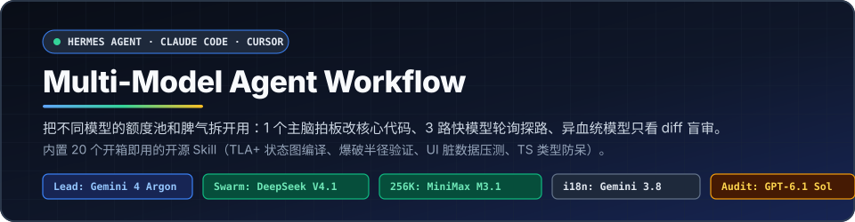
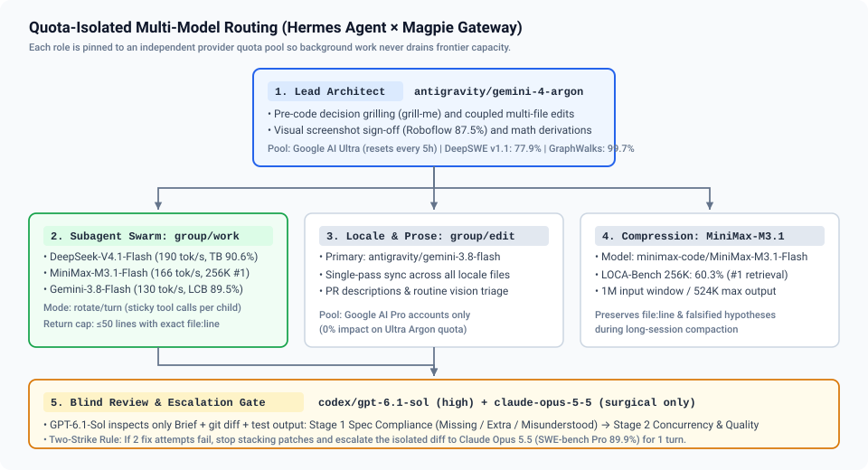
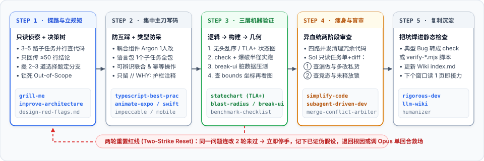

<div align="center">



[](./LICENSE)
[](./skills)
[](#最快上手)
[](./README.en.md)

<p>一套按照真实工程痛点搭出来的多模型协作流，外加开箱即用的 20 个高频工程技能。</p>

[English](./README.en.md) · **简体中文** · [实测基准](./docs/benchmarks-2026-11.md) · [工程模式拆解](./docs/power-user-patterns.md)

</div>

---

在vibe coding 过程中，我常被两件事搞崩：

一是**额度烧得快，速度还很慢**。拿推理成本极高的主力模型去跑全局 `grep`，或者把所有子任务塞给同一个免费慢模型排队。结果主会话额度撑不过半天，子任务通道全堵死。

二是**并发写代码搞出分支灾难**。让好几个子智能体同时碰互相依赖的前端组件、状态流和多语言字典，半小时后代码冲突到连测试都跑不起来，只能全盘回滚。

这套配置的核心思路很朴素：
1. **主窗口只留给大模型做架构判断与核心改动**，看图查 UI、推导复杂状态机最准。
2. **读仓库和跑腿交给三个不同厂商的快模型轮询**，并发查资料不撞单账号限频。
3. **审代码换另一个血统的模型只读 diff 盲审**，谁写的谁别审，一眼看出计划外夹带的私货。

<div align="center">
  
</div>

---

## 最快上手

仓库里的 `skills/` 已经内置了整理完毕的 20 个工程技能，保留全部上游许可证，克隆后跑一行脚本就能装好。

```bash
git clone https://github.com/dreamfarer-space/multi-model-agent-workflow.git
cd multi-model-agent-workflow

# 1. 安装 20 个技能（支持 hermes / claude / cursor / agents）
bash scripts/install-skills.sh --target hermes

# 2. 如果用 Magpie 聚合网关，跑脚本建好路由分组
bash scripts/setup-magpie-groups.sh
```

如果你用 Hermes Agent，把以下配置写入环境即可跑起来（完整模板见 `configs/hermes-config.example.yaml`）：

```bash
hermes config set model.default antigravity/gemini-4-argon
hermes config set delegation.model group/work
hermes config set auxiliary.compression.model minimax-code/MiniMax-M3.1-Flash
hermes config set auxiliary.review.model codex/gpt-6.1-sol
hermes config set auxiliary.background_review.model codex/gpt-6.1-sol
hermes config set auxiliary.background_review.reasoning_effort high
```

---

## 岗位模型怎么挑

写代码时不同模型的脾气差别很大，详细数据点与第三方推算方法见 [基准测试汇总文档](./docs/benchmarks-2026-11.md)。日常开发各司其职即可，没必要让旗舰模型干杂活：

| 角色 | 路由 / 配置项 | 公开测试基准 | 为什么选它 |
| :--- | :--- | :--- | :--- |
| **主窗口逻辑决策** | `antigravity/gemini-4-argon`<br>`model.default` | DeepSWE v1.1 `77.9%`<br>GraphWalks 128K `99.7%`<br>Roboflow 视觉 `87.5%` | 跨文件调用链追踪、查 UI 截图对齐极稳。首字思考通常要等十几秒，所以别派它去遍历文件，只让它做方案抉择和改动核心耦合代码。走 Google AI Ultra 池（5 小时重置周期）。 |
| **子任务侦察轮询** | `group/work`<br>`routing=rotate, stays=turn` | DeepSeek-V4.1-Flash (`190 tok/s`)<br>MiniMax-M3.1-Flash (`166 tok/s`)<br>Gemini-3.8-Flash (`130 tok/s`) | 派出去查资料的子任务，按轮询摊到腾讯、MiniMax 和 Google Pro 三家，谁也不卡谁。`stays=turn` 能让单个子任务在多轮工具调用时不乱跳模型。另外挂了 `workbuddy/hy4free` 兜底。 |
| **多语言与文案生成** | `antigravity/gemini-3.8-flash`<br>`group/edit` | LMArena 中文视觉第 1<br>LiveCodeBench `89.5%` | 锁在 Google AI Pro 账号池，省下 Ultra 额度。专门负责一次性对齐多语言字典（`locales/*.ts`）和整理发版说明，单次吞吐快。 |
| **长上下文压缩** | `minimax-code/MiniMax-M3.1-Flash`<br>`auxiliary.compression` | LOCA-Bench 256K `60.3%`（长程检索第一）<br>最大单次输出 `524K` | 会话过长触发自动压缩时切过来，长记忆保留能力强，不会把前面已经排查过的 `file:line` 和证伪结论弄丢。 |
| **盲审查漏 & 救场** | 盲审：`codex/gpt-6.1-sol:high`<br>救场：`claude-opus-5-5` | Sol：DeepSWE `75.2%`、指令遵循 `82.0%`<br>Opus 5.5：SWE-bench Pro `89.9%` | 主窗口写代码，提交前换 OpenAI 血统的 Sol 专门挑刺。Opus 5.5 额度珍贵，不挂主窗口跑长任务，只在主模型连改两轮依然卡死时切过去单回合定位根因。 |

---

## 日常工程流水线

<div align="center">
  
</div>

这套流程综合了 Boris Cherny、Jesse Vincent (`superpowers`)、Garry Tan (`gstack`)、Matt Pocock (`grill-me`)、Emil Kowalski 和 Lauren Tan (`cursor/pstack`) 的实战经验，更深层次的设计背景写在 [高阶用法解析](./docs/power-user-patterns.md)。

### 1. 先定边界，问清分支再写代码

主窗口绝不自己翻大文件。先派 3 到 5 个只读子任务去侦察，硬性限制每个子任务返回摘要**不超过 50 行，必须附带明确的 `file:line` 坐标**，拒绝几十屏原始日志刷屏。

一旦碰到技术选型或架构分支，主模型用 `grill-me` 抛出 2 到 3 个带明确倾向的选择题，把方案定死，并在开工前列出本次明确不改动的文件列表（`Out of Scope`）。代码里能查出来的客观事实自己查，不打扰人。

### 2. 耦合代码单人改，两轮不过立刻停手

相互接线的组件、全局 Store 和路由流，必须由主窗口的 `Argon` 一口气写完。改多语言文案时，等中文或英文基准改完，派一个 `Gemini 3.8 Flash` 一次性写完整套语言包，坚决不拆成多个子任务并发写。

写 TypeScript 遵循内置的规范：用可辨识联合（Discriminated Unions）代替随处乱飞的布尔标记，在网络和存储边界用 Zod 解析收敛类型，状态变更要求幂等。代码注释只写 `// WHY:`，交代平台坑点或协议限制，省得后面其他模型接手时顺手删掉关键防御逻辑。

**两轮重置原则**：如果一个 Bug 连续改了两轮测试还没过，立刻停手，禁止盲目叠加第三层补丁。退回到初始上下文重新检查假设，或者临时切到 `opus` 单点排查。

### 3. 三层机器验证，不用肉眼脑补

首先抽离状态机逻辑。碰到复杂的重连、抢占或权限流，把状态逻辑抽出来跑乱序测试，或者借由 `statechart` 调用 TLC 将 TLA+ 规格直接输出为 Mermaid 图和最短反例路径。

其次看真实运行态证据。单测跑通后，用 `blast-radius` 梳理跨模块改动依赖的那个关键事实，写极简脚本测它一下；没拿到运行期证据的调用点老老实实标为 `UNPROVEN`。汇报性能变化必须走完 `benchmark-checklist` 的 7 项核实。

最后用极端数据推测几何排版。用 `break-ui` 的长德语词、长邮箱和极端空/满列表压测布局，抓取 Android `bounds` 或 DOM `getBoundingClientRect` 坐标，核对无误后再截亮暗色图发给主模型核验。

### 4. 代码精简与异血统盲审

改动过大时先调 `simplify-code`，分头筛一遍是否有现成库函数可用、是否有没关的监听句柄以及多余状态。

准备提交前，把分支交给 `GPT-6.1-Sol (high)`。审代码时不带之前的聊天上下文，只给任务说明、真实 `git diff` 与测试输出：
* 第一遍对账需求：有没有少写，以及有没有自作聪明添加了计划外的私货。
* 第二遍查健壮性：重点揪资源泄漏、竞态时序和错误捕获缺失。

### 5. 踩过的坑变成静态检查（Lint-as-Memory）

大模型会遗忘写在文档里的规则，但通不过 CI 脚本就无法合入。每解决一个典型暗坑（比如多层内边距嵌套、写死十六进制色值、遗漏本地化字段），随手在项目的检查脚本里补一条正则或静态断言。

遇到核心推导或重要方案设计，用 `llm-wiki` 沉淀进本地知识库的索引里，后续开新窗口读一页 `index.md` 就能继续上下文。

---

<details>
<summary><b>展开查看 20 个内置工程技能与协议清单</b></summary>
<br>

所有技能均放置于 [`skills/`](./skills) 目录。完整修改说明与协议条款见 [`THIRD_PARTY_NOTICES.md`](./THIRD_PARTY_NOTICES.md)。

| 领域 | 技能目录 | 具体用途 | 来源与许可证 |
| :--- | :--- | :--- | :--- |
| **架构与开发主线** | `rigorous-dev` | 串联分支排查、两轮重置、几何验证与盲审的主线流程 | MIT (`Nous Research` / 本项目扩展) |
| | `grill-me` | 动手前按决策分支向开发者提问，带有推荐解 | MIT (`mattpocock/skills`) |
| | `improve-codebase-architecture` | 识别浅层模块封装，拦截三类常见架构坏味道 | MIT (`mattpocock/skills` + `cursor/pstack`) |
| | `typescript-best-practices` | 可辨识联合、名义类型、边界 Zod 校验与穷尽匹配 | MIT (`cursor/plugins/pstack`) |
| | `blast-radius` | 评估跨模块修改影响面，建立运行期证据梯 | MIT (`cursor/plugins/pstack`) |
| | `statechart` | 基于 SANY 与 TLC 将 TLA+ 规格编译为 Mermaid 状态图和反例链 | MIT (`cursor/plugins/pstack`) |
| | `benchmark-checklist` | 性能汇报前的 7 项防夸大与实测基准核查清单 | MIT (`cursor/plugins/pstack`) |
| | `simplify-code` | 从复用、清晰度、性能三个角度精简近期改动 | MIT (`Nous Research`) |
| | `subagent-driven-development` | 驱动子任务并在交付前跑规格与质量双审查 | MIT (`obra/superpowers`) |
| | `agent-merge-conflict-arbiter` | 结合双方提交意图与测试结果仲裁 Git 冲突 | MIT (`Nous Research`) |
| **界面交互与多端** | `vercel-react-native-skills` | React Native / Expo 列表渲染、布局与原生交互准则 | MIT (`vercel-labs/agent-skills`) |
| | `animate-expo` | Reanimated 动效门禁，高频操作防卡顿与 UI 线程手势 | MIT (`emilkowalski/skills`) |
| | `break-ui` | 注入长德语字符串、极端邮箱和空满数据压测边界 | MIT (`emilkowalski/skills`) |
| | `mobile-native` | 规避移动端 Web 的 `:hover` 残留、视口高度与表单缩放问题 | MIT (`emilkowalski/skills`) |
| | `write-swift` | Swift 现代值类型设计与递进式并发规范 | MIT (`emilkowalski/skills`) |
| | `emil-design-eng` | Emil Kowalski 的 UI 细节与过渡缓动时间标准 | MIT (`emilkowalski/skills`) |
| | `impeccable` | 页面排版、对比度、视觉层级与反 AI 模板化指引 | Apache-2.0 (`pbakaus/impeccable`) |
| | `frontend-design` | 避免千篇一律的前端排版与质感设计准则 | Apache-2.0 (`anthropics/skills`) |
| **文档与知识管理** | `humanizer` | 过滤 34 种典型的大模型八股句式和虚假修饰词 | MIT (`blader/humanizer`) |
| | `llm-wiki` | 依托 `raw/`、`concepts/` 和 `index.md` 维护增量知识库 | MIT (`Nous Research`) |

</details>

---

<details>
<summary><b>查看项目文件结构</b></summary>
<br>

```text
.
├── README.md                          # 中文说明
├── README.en.md                       # 英文说明
├── LICENSE                            # 项目自有代码 MIT 协议
├── THIRD_PARTY_NOTICES.md             # 内置 20 个技能的上游版权与许可信息
├── assets/
│   ├── hero.svg                       # 顶部题图
│   ├── model-routing.svg              # 模型角色与路由拓扑
│   └── pipeline.svg                   # 五步验证流水线示意图
├── configs/
│   └── hermes-config.example.yaml     # Hermes 路由组与防循环策略配置模板
├── scripts/
│   ├── install-skills.sh              # 技能安装脚本（Hermes / Claude / Cursor / .agents）
│   └── setup-magpie-groups.sh         # Magpie 路由分组创建脚本
├── skills/                            # 开箱即用的 20 个工程技能
│   ├── autonomous-ai-agents/
│   ├── creative/
│   ├── research/
│   └── software-development/
└── docs/
    ├── benchmarks-2026-11.md          # 各主力模型实测数据及核验记录
    └── power-user-patterns.md         # 工程模式与验收思路深度拆解
```

</details>

---

## 协议

本仓库新增的配置、图表与文档采用 [MIT 许可证](./LICENSE)。内置在 `skills/` 下的第三方开源项目各自遵循其原始的 **MIT** 或 **Apache 2.0** 许可证，详见各子目录及根目录的 [第三方版权声明文件](./THIRD_PARTY_NOTICES.md)。
